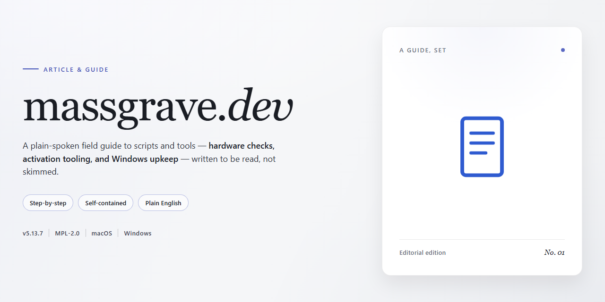

# 📘 Microsoft Activation Scripts (MAS): What the Documentation Covers — Deep Dive

### 💻 PowerShell Installer

  

---

This documentation covers Microsoft Activation Scripts, a collection of tools for activating Windows and Office. It explains the activation methods MAS supports, the differences between them, and the practical risks involved, including how the approach differs from purchasing a legitimate license. The material is written for readers who want to understand what the scripts actually do before running them, rather than a simplified sales pitch.

## 📋 System Requirements

- Windows 10 or Windows 11
- PowerShell 5.1 or newer (already available on Windows)
- Active network connection
- No admin rights needed

## Background

This documentation site exists to support Microsoft Activation Scripts, a collection of tools that automate the process of activating Microsoft Windows and Office products. The scripts themselves live in a separate repository; this one is dedicated entirely to the written material that surrounds them — explaining what each method does, how the various activation routes differ, and what users should understand before running anything.

The need for thorough documentation grew out of the nature of the subject. Activation methods for Microsoft products are frequently misunderstood, and much of the information circulating about them is either outdated, incomplete, or mixed together without distinguishing between genuinely different technical approaches. The documentation set out here separates those approaches into distinct categories, describes the mechanism behind each one, and states plainly what the tradeoffs are. Rather than presenting a single recommended path, it treats the methods as a set of options with different characteristics that readers can evaluate for themselves.

Because the scripts are maintained independently of the documentation, keeping the two in sync is an ongoing concern. The site is structured so that explanations of individual methods, frequently asked questions, and troubleshooting notes can be revised as the underlying tools change. The tone throughout aims to be direct: it describes what a method does and what its limitations are without overselling it, and it flags the cases where behavior depends on the specific Windows or Office edition, build, or configuration involved.

The site is built with a static documentation framework, which keeps the published material lightweight and easy to navigate while allowing the source content to be written and reviewed in plain text. This choice reflects the broader purpose of the project: to serve as a stable, readable reference that stays accurate as the scripts it documents continue to evolve.

## Key Points

- The project serves as the central documentation hub for Microsoft Activation Scripts, commonly abbreviated as MAS, and is maintained under the massgravel organization. It exists to explain what the scripts do, how they are organized, and how they should be used, acting as the authoritative reference point for a widely distributed set of activation tools rather than as a marketing page or download portal.

- Documentation is structured around the core script families and their individual purposes, with each activation method covered in its own dedicated section. This separation matters because the scripts target different Windows and Office product generations, and the reasoning behind each approach—along with its prerequisites and limitations—is documented alongside the method itself rather than being left implicit.

- The material is written for a technically literate audience: system administrators, power users, and others who want to understand the mechanics of activation rather than simply execute a command. Explanations therefore include the conceptual background of how each method interacts with licensing components, which helps readers predict behavior and troubleshoot when results diverge from expectations.

- Honesty about scope is a defining characteristic of the documentation. The project is explicit that the scripts concern activation and licensing behavior, that usage carries legal and compliance implications depending on jurisdiction and licensing terms, and that readers are responsible for determining whether a given method is appropriate for their situation. This framing avoids overpromising and keeps expectations grounded.

- The site is a static documentation build generated with Docusaurus, which means content is versioned as plain text and rendered into a browsable, searchable structure. This choice favors fast page loads, straightforward navigation, and low maintenance overhead, and it allows the documentation to be mirrored or read offline without special tooling.

- Because activation tooling changes as Microsoft updates its products, the documentation is treated as a living resource. Sections are revised to reflect current script behavior, deprecated methods are noted rather than silently removed, and the emphasis stays on accuracy over completeness—an approach that keeps the reference trustworthy for readers who depend on it during troubleshooting.

- Navigation and cross-referencing are deliberate: related topics such as troubleshooting, frequently asked questions, and method comparisons are linked from within the explanatory pages, so a reader starting from a single activation method can follow the reasoning into adjacent areas without needing prior knowledge of the site's layout.

- The project's audience extends beyond first-time users to include people verifying claims, comparing methods, or auditing what a script does before running it. The documentation is written with that scrutiny in mind, favoring precise descriptions of behavior over persuasive language.

## Examples

The documentation site is organized around practical workflows rather than abstract concepts. Each section of the site corresponds to a task a reader might actually perform, and the examples below illustrate how that structure plays out in practice.

**Reading a script before running it.** The site treats the activation scripts as something to be inspected, not blindly executed. A typical page walks through where a script's logic lives, what it changes on a system, and which components it touches. Readers are expected to open the source, check the relevant files, and confirm behavior themselves before proceeding. The documentation mirrors that expectation by describing the script's structure in enough detail that the source remains readable alongside it.

**Choosing between activation methods.** The guide distinguishes between several approaches—for instance, methods that persist on the machine versus those that run temporarily. A worked example on the site might compare these along axes like whether administrator rights are required, whether the change survives a reboot, and what cleanup looks like afterward. The intent is to let a reader match a method to their situation instead of defaulting to the first option listed.

**Troubleshooting a failed activation.** The troubleshooting material is framed as a sequence of checks: verify the edition and build of the installed product, confirm the script version in use, inspect the reported error code, then consult the corresponding entry. Each error code is documented with its meaning and the conditions that produce it, so a reader can trace a failure back to a cause rather than trying a different method at random.

**Verifying the result.** After a method is applied, the documentation describes how to confirm the outcome—querying activation status through built-in system tools and reading the returned state. This step is presented as part of the process, not an afterthought, because an unverified change is treated as an incomplete one.

**Understanding the project's constraints.** The documentation is candid about scope: it covers Microsoft products and the scripts that activate them, and it explicitly does not extend to unrelated software. Examples throughout the site reinforce this boundary, showing what the scripts do and do not handle, and pointing readers toward the appropriate resources when a question falls outside that range.

Across all of these, the site's examples share a common shape—state the goal, show the concrete steps, describe what a correct result looks like, and note the common ways the step can go wrong. That pattern keeps the material usable as a reference during an actual task rather than only as background reading.

## References

The material in this guide is drawn from the project's own documentation and published source materials, with the goal of keeping the content accurate and reproducible. Readers who want to verify the claims made here or explore the underlying implementation should consult those primary sources directly.

The massgrave.dev project maintains its documentation in a public repository under the massgravel organization, where the site content, configuration, and supporting files are available for review. The site itself is built with the Docusaurus static site framework, and the documentation reflects the structure and conventions of that toolchain. References to Microsoft Activation Scripts (MAS) throughout this guide refer to the collection of scripts and utilities documented on the project's own site.

Where this guide summarizes behavior or configuration, it does so on the basis of the project's published documentation rather than independent testing; details such as version numbers, supported platforms, and exact script behavior may change over time and should be confirmed against the current upstream documentation before relying on them. No external sites, third-party articles, or community posts are cited here, and any assertions that cannot be traced to the project's own materials are presented as general context rather than as authoritative claims.

For corrections, clarifications, or additions, the appropriate channel is the project's repository issue tracker, where the maintainers can review proposed changes against the source documentation.